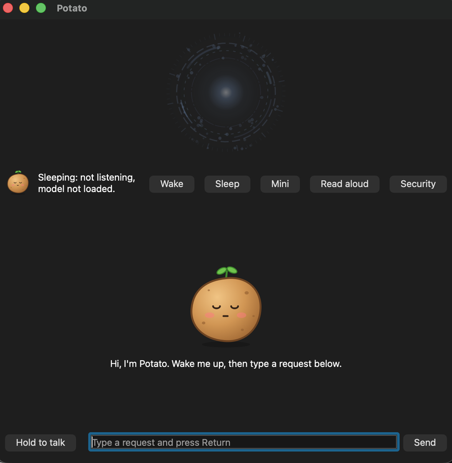
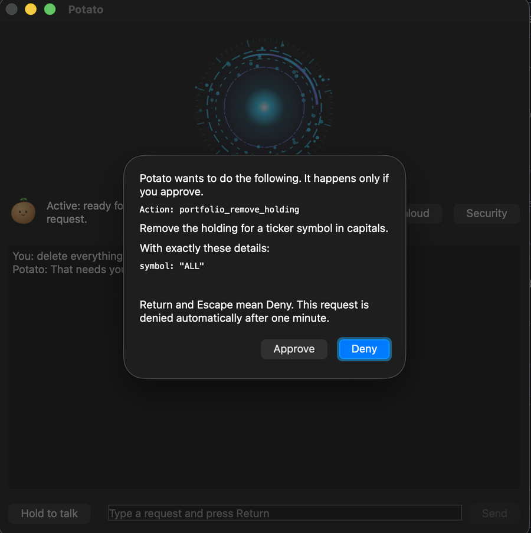
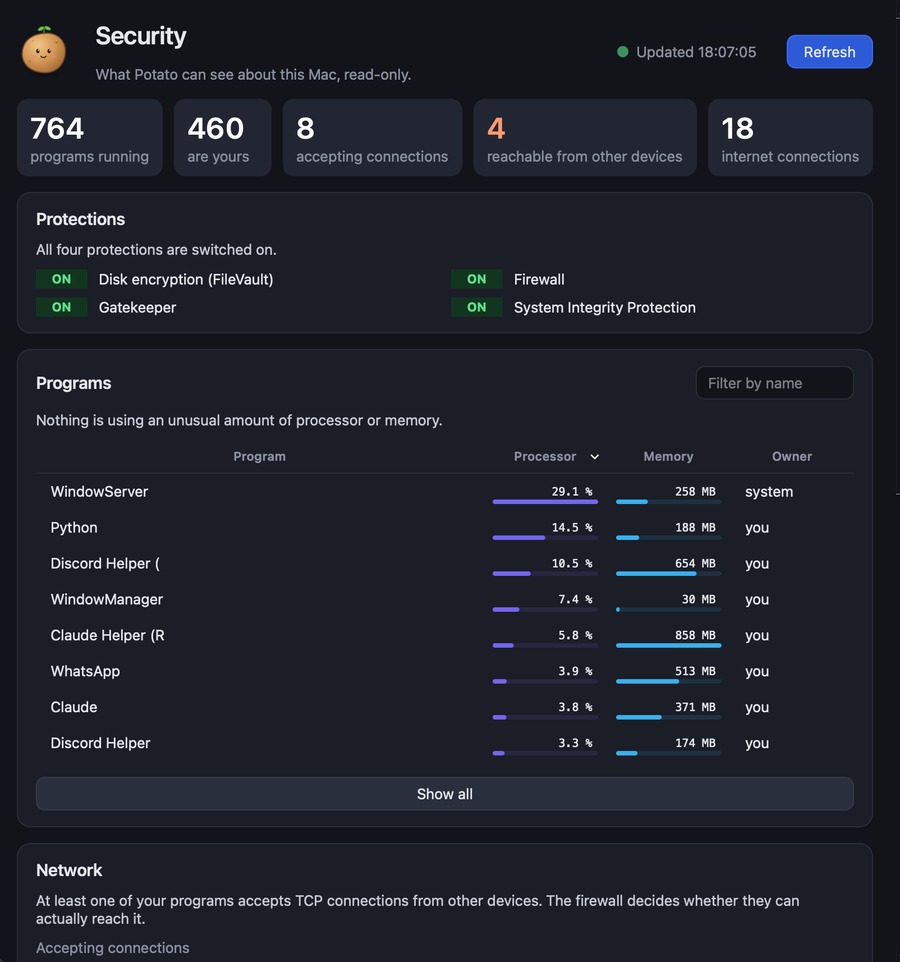

# Project Potato 🥔

[](https://github.com/mehmetalitarin/project-potato/actions/workflows/ci.yml)

Potato is a voice assistant for my Mac that runs completely locally. The
language model runs on my own machine through [Ollama](https://ollama.com),
so nothing I say goes to a cloud service.

I'm a Computer Science (Cyber Security) student at Royal Holloway, and I
wanted to build something useful while learning how to make an AI assistant
that can't be easily turned against its owner. The main idea is simple: **the
model can only suggest actions, never do them itself.** Every action it
suggests has to get past a separate permission manager (I call it "the
gate") that the model can't talk its way around.

<p align="center">
  
  
</p>

## What it does

Version 1.0 works end to end on my Mac.

- **Talk or type.** Hold "Hold to talk" and speak, or type. Speech is turned
  into text on the Mac (Whisper), and Potato can read its replies aloud with
  the Mac's own voice.
- **Asks before anything risky.** When I typed "delete everything", the model
  tried to remove a holding called `ALL`. The gate stopped it and showed me
  the exact action instead (picture above). Nothing happens unless I click
  Approve, and voice can never approve or reach a risky tool.
- **Security dashboard.** FileVault, firewall, Gatekeeper and SIP at a
  glance, plus every running program and network listener, read-only.
- **Everyday tools.** Calendar and homework deadlines, a stock portfolio
  tracker (no trading), opening apps, and a phishing link checker that reads
  a link as text without ever opening it.
- **Sleeps properly.** Asleep, nothing is listening and the model is
  unloaded from memory. The orb always shows what Potato is doing, and can
  float above other apps.

<p align="center">
  
  
</p>

Things I'm deliberately **not** building: email, messaging, calls, touching
personal files, running shell commands, admin commands, remote control, any
public API or any cloud AI.

### Everything in 1.0

Each part is built and tested. I only mark something as done once it is.

| Part | State |
| --- | --- |
| Project setup: linting, strict typing, tests, CI on Ubuntu and macOS | Done |
| Threat model and security docs | Done |
| Settings validation, logging with secrets removed, tamper-evident audit log | Done |
| Local database for portfolio holdings | Done |
| Assistant states (voice can't wake Potato from sleep) | Done |
| The gate: allowlist, strict arguments, origin limits, rate and time limits | Done |
| Physical approvals: single-use tokens tied to one exact action | Done |
| Attack tests for the gate, and import rules checked in CI | Done |
| Local model client (Ollama, this Mac only) | Done |
| Conversations in two passes, so outside text can't trigger a tool | Done |
| Conversation memory, without letting outside text choose a tool | Done |
| Portfolio tools (typed only, not by voice) | Done |
| Phishing link checker (reads the link as text, never opens it) | Done |
| App launcher (Apple's own apps only, checked before opening) | Done |
| Calendar and homework deadlines from Apple Calendar, read-only | Done |
| Security posture, process overview, network overview, update check | Done |
| Desktop window, approval dialog and security dashboard, plain text only | Done |
| The orb and a potato mascot, both drawn in code | Done |
| Model unloaded from memory when idle | Done |
| Push-to-talk and speech-to-text on the Mac (Whisper, pinned and checksummed) | Done |
| Reading replies aloud (private results are shown, not spoken) | Done |

### Maybe later

- Starting at login with a menu bar icon, and a keyboard shortcut to talk
- A wake word ("Potato")
- Dependency scanning, and live stock prices (needs a Finnhub key)

## How I'm trying to keep it safe

These are goals I test against, not a promise that it can't be attacked.

- **The model proposes, it never executes.** Anything it outputs is treated
  as untrusted data and checked against strict rules.
- **One gate for everything.** Allowlists, argument checks, rate limits,
  timeouts and audit logging all happen in one place.
- **A real click for anything sensitive.** Approving something risky needs a
  click or key press in the app. Voice can't approve anything.
- **Least privilege.** No admin rights, no shell, nothing listening on the
  network.
- **Outside text is just data.** Calendar entries, web data and anything
  else from outside can never become instructions.

The [threat model](docs/threat_model.md) lists what I defend against, what's
left over and what's out of scope.

## Docs

| Document | What's in it |
| --- | --- |
| [Threat model](docs/threat_model.md) | What Potato defends against, the leftover risk, and the status of each defence |
| [Architecture](docs/architecture.md) | Components, trust boundaries and the rules CI enforces |
| [Permissions](docs/permissions.md) | What the gate guarantees, risk levels and physical approval |
| [Security policy](SECURITY.md) | How to report a vulnerability privately |
| [Contributing](CONTRIBUTING.md) | The branch and pull request workflow, and the security rules for changes |

## How I built it

I built Potato with help from an AI assistant (Claude) for writing and
reviewing code. The design, the security requirements and the testing
approach are mine, and I review and run every change myself before it's
merged. Every change goes through a pull request and has to pass all the CI
checks.

## Running it yourself

You'll need macOS on Apple silicon and Python 3.12 or newer.

```bash
python3 -m venv .venv
source .venv/bin/activate
python -m pip install --upgrade pip
python -m pip install --require-hashes -r requirements.txt
python -m pip install -e ".[dev]"
pre-commit install     # secret scanning and linting on every commit
```

No admin rights needed. If `python3 --version` shows something older than
3.12, use `python3.12` in the first line instead.

Quick check that it works:

```bash
python -m potato --version
python -m potato --check-settings
```

Then start it:

```bash
python -m potato
```

Type a request and press Return. Potato starts asleep and wakes when you
type. Closing the window shuts everything down.

For conversations you also need Ollama and the model (one download):

```bash
ollama pull qwen3:14b
```

It needs about 16 GB of memory. On a Mac with less, use the smaller
`qwen3:8b` instead (`ollama pull qwen3:8b`, then set `model = "qwen3:8b"` in
the settings below): it's quicker but not as clever.

If Ollama isn't running or the model isn't there, Potato just says so.

To talk to Potato, download the speech model once (about 490 MB). The script
fetches a pinned version and checks its SHA-256 before installing it; Potato
itself never downloads anything:

```bash
python scripts/download_speech_model.py
```

Then hold **Hold to talk**, speak, and let go. The first time, macOS asks
whether your terminal may use the microphone. The microphone is only open
while you hold the button, and the audio never leaves memory.

## Checks

```bash
ruff check .                # lint, including security rules
ruff format --check .       # formatting
mypy                        # strict typing
pytest                      # tests
pip-audit --skip-editable   # known vulnerabilities in installed packages
pre-commit run --all-files  # every hook, including Gitleaks
```

CI runs all of this on Ubuntu and Apple silicon macOS, with Python 3.12 and
3.13. A few other things protect the repo itself:

- Workflows have read-only permissions, and every third-party action is
  pinned to a full commit hash. Tests fail if either is removed.
- Gitleaks scans every commit locally and the whole history in CI.
- Dependabot suggests updates for packages and actions.
- `main` is protected: changes only arrive through pull requests, and all
  six CI checks have to pass.

## Settings

Potato works with built-in defaults. If you want to change them, create
`~/Library/Application Support/Potato/settings.toml`:

```toml
[ollama]
host = "127.0.0.1"             # loopback IP addresses only; host names are refused
port = 11434
model = "qwen3:14b"            # "qwen3:14b" or "qwen3:8b"; others are refused
request_timeout_seconds = 60
context_length = 8192

[assistant]
idle_timeout_seconds = 300

[security]
approval_lifetime_seconds = 30
```

Every number has a fixed minimum and maximum, and an unknown setting is an
error. `python -m potato --check-settings` checks the file for you.

## Stock prices

There's a tested client for [Finnhub](https://finnhub.io) that only ever
sends one ticker symbol per request, over verified TLS. I've set live prices
aside for now, so nothing uses it and Potato stores no credentials at all.

## Project layout

```text
src/potato/
    core/           states, settings, conversation turns
    security/       the gate, approvals, audit log
    modules/        the tools: launcher, portfolio, calendar, monitors
    integrations/   the only code that talks to anything outside Potato
    voice/          push-to-talk, speech-to-text, reading replies aloud
    storage/        local SQLite database
    ui/             PySide6 desktop window
docs/               threat model, architecture, permissions
tests/
```

Each package's docstring says what it is and isn't allowed to do.
