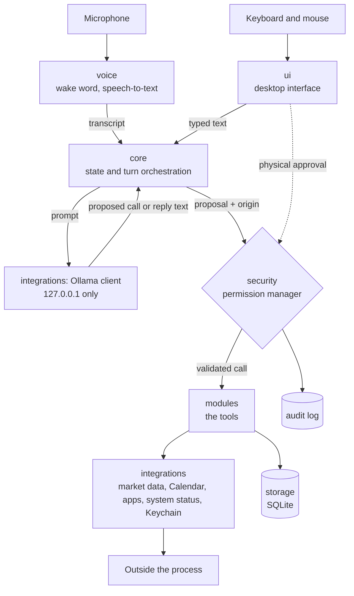
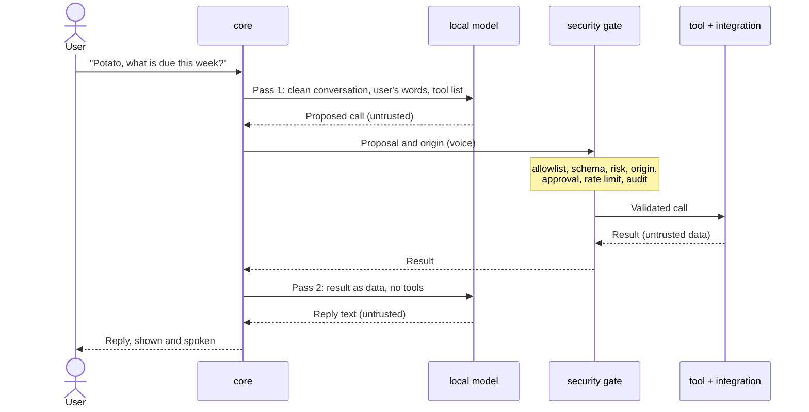

# Architecture

> **Status: design document.** Potato is pre-alpha. The package layout exists;
> the components described here are built one milestone at a time. Each rule
> below says how it is enforced and whether that enforcement exists yet.

Related documents: [threat model](threat_model.md),
[permissions](permissions.md).

## The idea in one paragraph

Potato is a single desktop process. A local language model turns the user's
words into a *proposed* action. A separate permission manager, which the
model cannot influence, decides whether that action runs. Tools do the work
through a thin layer that is the only code allowed to touch the operating
system or the network. Results come back as data, and the model summarises
them in a pass where it has no tools.

## Components

Everything arriving from the microphone, from the model and from outside the
process is untrusted. The permission manager is the only path from a
proposal to a tool.

## One turn, step by step

1. **Input.** Words arrive by voice or keyboard. The code that received them
   records the *origin*. The model never sets it.
2. **Pass 1: choose.** The model sees the fixed system prompt, the tools this
   origin may use, the clean part of the conversation so far (below) and the
   user's own words from this turn. It may propose up to three calls; if it
   proposes more, none run. It has seen no external data at this point. If it
   proposes nothing, its answer is the reply and the turn ends here.
3. **Gate.** Each proposal is checked as described in
   [permissions.md](permissions.md). A denial is a fixed message. If nothing
   ran, the reply is built from those fixed messages and the model is not
   asked again.
4. **Run.** The tool runs with validated, typed arguments, under a timeout.
5. **Pass 2: summarise.** Results go to the model as data with length
   caps. The model is offered no tools in this pass, a tool call it makes
   anyway is refused, and the turn does not read proposals from it. Nothing
   in the data can cause an action.
6. **Output.** The reply is shown as plain text and may be spoken. The
   interface also shows the underlying data directly from code.

**Conversation memory, with taint tracking.** Potato remembers the last 12
messages, so "my name is Mehmet" and "and next week?" work. Each remembered
message is marked by where it came from:

| Remembered message | Mark | Seen by pass 1 | Seen by pass 2 |
| --- | --- | --- | --- |
| The user's own words | Clean | Yes | Yes |
| A fixed sentence written in Potato's code | Clean | Yes | Yes |
| A reply written in pass 1, from clean messages only | Clean | Yes | Yes |
| A reply written in pass 2, after reading tool results | **Tainted** | **No** | Yes |
| Anything from a spoken turn, when the current turn is typed or from the interface | Clean, but from a turn with less reach | **No** | Yes |

So tool results, and every reply built from them, never reach a later pass 1.
And a pass 1 sees a remembered message only if its turn could reach at least
every tool the current turn can: a spoken request that voice was not allowed
to carry out cannot be carried out by the next typed turn instead.
Injected text cannot wait a turn and then choose a tool. The cost is that
Potato cannot act on something only a tool result said: the user has to ask
in their own words. The memory is held in the turn engine only, never written
to disk or a log, capped at 6,000 characters, and forgotten whenever Potato
leaves the active state.

## Packages

| Package | Owns | Must never |
| --- | --- | --- |
| `core` | Assistant state, configuration, turn orchestration | Call a tool or the operating system directly |
| `security` | Permission manager, approvals, audit log, log redaction | Take a decision from model output |
| `modules` | The tools: launcher, portfolio, calendar summaries, security monitors, link analysis, dependency reports | Run without a validated call from `security` |
| `integrations` | The only code that touches anything outside the process | Accept free-form input from the model |
| `voice` | Microphone, wake word, speech-to-text, text-to-speech | Approve anything |
| `storage` | SQLite access | Store a secret |
| `ui` | The desktop interface; the only place an approval can start | Contain business logic |

Each package's docstring in `src/potato/` repeats its boundary.

## Rules

Stable IDs, so that tests and checks can name the rule they enforce.

| ID | Rule | Enforced by | Status |
| --- | --- | --- | --- |
| R1 | **One gate.** A tool runs only when `security` hands it a validated call. | Tool functions are reachable only through the gate; tests call them no other way. Random requests are checked against a separate statement of the rules (`tests/test_gate_security.py`). | Partly done |
| R2 | **The orchestrator cannot reach the tools.** `core` does not import `modules`, and imports `integrations` only for the Ollama client. | An import contract checked in CI (`tests/test_architecture.py`). | Done |
| R3 | **No shell, and one place for processes.** Nothing uses a shell, `eval` or `exec`. A single module in `integrations` may start a process, with absolute paths and fixed arguments. | Ruff security rules and `tests/test_architecture.py`, both active now. The single module is `potato.integrations.processes`, named in that test. | Done |
| R4 | **Only the interface creates approvals.** The object that makes approvals is made once at start-up, handed to the interface and to nothing else, and `voice` cannot reach it. | A test that fails if code outside the interface package and the start-up module refers to it; a test that reads the start-up module and fails unless the object is used exactly once, as the argument that hands it to the window (`tests/test_app.py`); a rule that no package may import the start-up module; and an import contract that keeps `voice` away from approvals, the interface and the tools (`tests/test_architecture.py`). | Done |
| R5 | **No listeners.** Potato opens no listening socket. Outbound connections are made only by `integrations`. Qt's own networking, web engine and remote-control modules are never used. | An import contract on networking libraries, Qt's included (`tests/test_architecture.py`), and tests that watch the Ollama client and the market data client for any socket being bound (`tests/test_ollama.py`, `tests/test_market_data.py`). | Done |
| R6 | **The model never chooses a tool with untrusted data in view.** Two passes, as above. The remembered conversation is taint-tracked: a reply written after reading tool results is never shown to the model while it chooses a tool. | Tests that plant instructions in tool results, in front of a fake model that obeys everything it reads and repeats it into its replies, and assert that no call follows, in that turn or later ones (`tests/test_turns.py`). | Done |
| R7 | **Allowlists are code.** The lists of tools, applications and model names, and each tool's risk level, are defined in source, not in settings. | The tools that are switched on are one list in the start-up module; a test pins that list and checks it against the table in [permissions.md](permissions.md) (`tests/test_app.py`). Settings validation rejects unknown fields. | Done |
| R8 | **Fail closed.** If a check cannot be completed, the answer is no. | Tests that inject errors into each check. At start-up, Potato does not start if its settings are invalid, its audit log cannot be opened safely or fails its integrity check, or another copy is running (`tests/test_app.py`). | Partly done |
| R9 | **No secrets outside the Keychain.** Not in source, settings, the database or logs. | Secret scanning and log redaction tests, both active now. | Partly done |

The import contracts are tests in `tests/test_architecture.py`. They read
every source file, and each one is itself tested against a planted
violation. Relative imports, star imports and run-time imports are not
allowed, because they would hide an import from these checks. The table of
which package may import which is in that file.

## Assistant states

Defined in `src/potato/core/state.py`, with every allowed change in one fixed
table. A test checks this table against the code. Microphone and model control
arrive in M7 and follow these states.

| State | Microphone | Wake word | Speech-to-text | Model in memory |
| --- | --- | --- | --- | --- |
| Off (not running) | Closed | Off | Off | No |
| Sleeping | Closed | Off | Off | No |
| Standby | Open | Listening | Off | No |
| Active | Open | Paused | On | Yes |
| Error | Closed | Off | Off | No |

- **Standby is not off.** The microphone stream is open so that the wake-word
  detector can hear "Potato". Nothing is transcribed and nothing is stored.
- **Sleeping** means nothing is listening. It is left by a click or a key
  press, never by voice. Mute puts Potato into this state.
- **Active returns to standby** after an idle timeout, and the model is
  unloaded from memory.
- **Error** closes the microphone. Potato never stays listening in a state it
  does not understand. If a component cannot follow a change of state, Potato
  moves here. It is left only from the interface.
- **Potato starts in Sleeping.** Nothing listens until the interface wakes it.
- **Voice only reduces.** Voice can turn the wake word into a conversation
  (Standby to Active) and can put Potato to sleep. Nothing else.
- **Speaking needs Active.** Replies are read aloud only while active, and
  only once the user turns on "Read aloud". Leaving the active state for any
  reason stops the voice at once; if it cannot be stopped, Potato moves to
  Error. The voice is macOS's own `say`, started from the one module that
  may start programs (R3), with the text cleaned, capped at 600 characters
  and sent on its input, never as an argument. A reply is cut off after 45
  seconds.
- **Opening is recorded first.** A change that opens the microphone or loads
  the model is written to the audit log before it happens, and is refused if
  it cannot be. A change that closes things is never blocked by the log.

## Start-up

`python -m potato` calls the start-up module (`src/potato/app.py`), the one
place where the parts are put together. Only the entry point may import it.

1. The settings are read and validated. Invalid settings stop Potato here.
2. The audit log is opened and its integrity checked. Opening it is also
   what refuses a second copy of Potato. If it cannot be opened safely,
   Potato does not start: it never runs without its audit log.
3. The approval pair is made. The gate gets the half that checks; the window
   gets the half that makes approvals. Nothing else keeps it (R4).
4. The gate is built from the fixed list of tools that are switched on (R7).
5. The window is shown. Potato starts in Sleeping, and nothing is sent to
   the model until the user acts.

While Potato runs, a timer sends it back to standby after the idle timeout,
unless a request or an approval is in progress. Whenever Potato leaves the
active state (idle timeout, Sleep, an error or quitting), Ollama is asked to
drop the model from memory. Ollama is also told to drop it by itself after
the same time, in case Potato is killed.

Closing the window denies anything still waiting for approval, puts Potato
to sleep, unloads the model and closes the audit log.

## The interface

The desktop window (`src/potato/ui/`, PySide6) is the only part of Potato a
person clicks. What it guarantees:

- **Plain text only.** Replies, labels and the user's own words are shown as
  plain text. Nothing is ever rendered as HTML or Markdown, so a reply cannot
  draw a fake button or warning, load an image or carry a link. Hidden and
  direction-changing characters are replaced with a visible marker first.
- **It states the origin.** Typed words go to the turn engine as `typed`.
  The words cannot change that.
- **One turn at a time, off the main thread.** The window stays responsive
  and the input is disabled until the turn ends.
- **Fixed sentences for failures.** An unexpected error is never shown as
  its own text.
- **Closing puts Potato to sleep**, which releases the microphone and the
  model.
- **The orb is an honest indicator.** The animated orb at the top of the
  window, and the floating bubble that can stand in for the window, are
  drawn by code from Potato's state alone. The state always wins: the orb
  can never look busy or attentive while Potato is asleep, so it doubles as a
  microphone indicator. It animates only while it can be seen. Changes of
  mode blend over half a second, but the mode itself changes at once, and
  when Potato wakes up the blend lasts only about a tenth of a second, so the
  orb never looks asleep while Potato could be listening.
- **The mascot is drawn by code.** The potato in the window, the dashboard
  and the app icon is painted with QPainter from fixed shapes. No image file
  is loaded, and it only shows two moods: sleepy while Potato sleeps, happy
  otherwise.
- **The dashboard goes through the gate.** The security dashboard runs its
  read-only tools through the gate as `interface`, so each run is checked,
  rate-limited and audited, and shows their own data formatted by code. The
  model is not involved. It asks for every entry and offers "Show all";
  an answer that long is replaced by a fixed note before the model could
  ever read it. While it is open it refreshes itself every 30 seconds, well
  inside the gate's limits; the update check, which contacts Apple, runs
  only when its button is pressed. It works while Potato is asleep, because
  opening it is the user's own click. Its style sheet is fixed text, and
  tool data only ever reaches the screen as plain-text labels and cells.
- **No way out.** No part of Potato may use Qt to open links or files in
  other applications, start programs or run scripts (`tests/test_architecture.py`).

The approval dialog (`src/potato/ui/approval.py`) is the only place an
approval can be given (R4):

- **What is shown is what runs.** Its text is built by code from the gate's
  validated copy of the action. An action that cannot be shown exactly
  cannot be approved.
- **Deny by default.** Return, Escape, closing the dialog, a minute without
  an answer and Potato leaving the active state all deny.
- **A real press only.** Approve acts only on a mouse or key event from the
  window system, and not in the first moment after the dialog appears.
- **Straight to the gate.** The approval is made inside the handler of that
  press, handed to the gate with the original origin, used once and never
  stored.

## Where data lives

| Data | Where | Notes |
| --- | --- | --- |
| Settings | Optional TOML file in the user's Library folder | Validated when read. Refused if another account could have written it (T-DATA-6). Holds no secrets. |
| Portfolio holdings | SQLite database in the user's Library folder | Ticker symbols and quantities only. Owner-only file permissions. Not separately encrypted (T-DATA-2). |
| Market data API key | macOS Keychain | The only credential (R9). |
| Application log, audit log | Log files in the user's Library folder | Owner-only, redacted and rotated. Audit entries are hash-chained (T-DATA-3). |
| Audio | Memory only | Never written to disk (T-VOICE-4). |
| Conversation | Memory only | Not logged (T-DATA-4). |
| Approval signing key | Memory only | New at every start (T-APPR-3). |
| Calendar events | Read on demand from Apple Calendar, through EventKit | Title, times and calendar name only. Not copied into the database, and not logged. |
| Running programs, network sockets | Read on demand with `ps` and `lsof` | Memory only. No command lines, and no remote addresses in results. Not logged (T-TOOL-4). |

## Network connections

Potato accepts no inbound connections (R5). These are all the outbound ones
planned for version 1.0.

| To | When | What is sent |
| --- | --- | --- |
| Ollama on `127.0.0.1` | Whenever the model is used | Prompts. Never leaves the Mac (T-LLM-6). |
| Finnhub (`finnhub.io`), over verified TLS | When prices are refreshed, if the user has stored an API key | One ticker symbol per request, and the API key in a header. No quantities (T-NET-4). |
| Vulnerability database | When the user runs a dependency scan | Names and versions of Potato's own Python packages. |
| Apple's update service | When the user asks for a security update check | Made by Apple's own tool, not by Potato's code. |

One-time set-up downloads (Python packages, the language model, the speech
models) are performed by the user, not by Potato.

## Why it is built this way

- **Why a gate instead of a careful prompt?** A prompt is a request to the
  model. A gate is code. Only one of them still works after the model has
  been talked into something.
- **Why two passes?** A model that can both read untrusted text and call
  tools can be steered by that text. Separating the two removes the route
  instead of trying to filter it.
- **Why taint tracking instead of no memory?** Without memory the assistant
  cannot follow a conversation, which makes it hard to use. Marking each
  remembered message by where it came from keeps the same guarantee as the
  two passes: nothing that came from outside is in view when a tool is
  chosen.
- **Why no plug-in system or agent framework?** They exist to let a model
  reach more things with less friction. This design wants the opposite.
- **Why so few dependencies?** Each one is code that runs with the user's
  rights and that nobody on this project wrote (T-SUPPLY-1).
