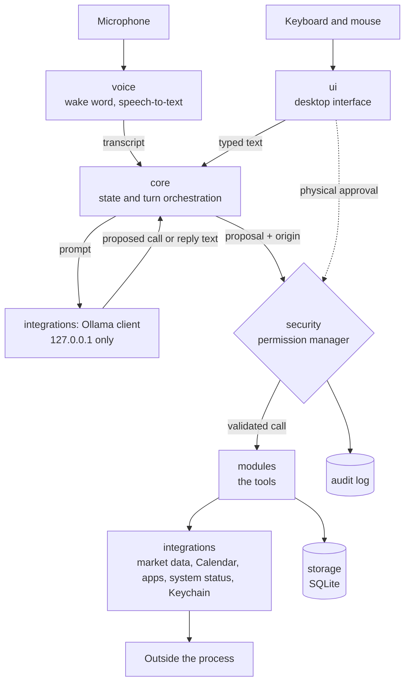
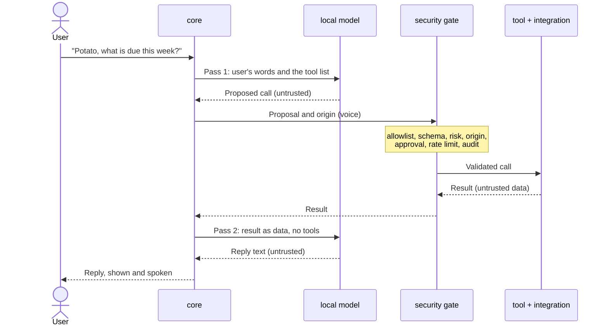

# Architecture

> **Status: design document.** Potato is pre-alpha. The package layout exists;
> the components described here are built one milestone at a time. Each rule
> below says how it is enforced and whether that enforcement exists yet.

Related documents: [threat model](threat_model.md),
[permissions](permissions.md).

## The idea in one paragraph

Potato is a single desktop process. A local language model turns the user's
words into a *proposed* action. A separate permission manager, which the
model cannot influence, decides whether that action runs. Tools do the work
through a thin layer that is the only code allowed to touch the operating
system or the network. Results come back as data, and the model summarises
them in a pass where it has no tools.

## Components

Everything arriving from the microphone, from the model and from outside the
process is untrusted. The permission manager is the only path from a
proposal to a tool.

## One turn, step by step

1. **Input.** Words arrive by voice or keyboard. The code that received them
   records the *origin*. The model never sets it.
2. **Pass 1: choose.** The model sees the fixed system prompt, the tools this
   origin may use, and the user's own words. It may propose a small, fixed
   number of calls. It has seen no external data at this point.
3. **Gate.** Each proposal is checked as described in
   [permissions.md](permissions.md). A denial goes back as a fixed message.
4. **Run.** The tool runs with validated, typed arguments, under a timeout.
5. **Pass 2: summarise.** Results go to the model as data fields with length
   caps. The model has no tools in this pass, so nothing in the data can
   cause an action.
6. **Output.** The reply is shown as plain text and may be spoken. The
   interface also shows the underlying data directly from code.

Tool results, and replies built from them, are never fed back into a later
pass 1. This closes the route by which injected text could wait a turn and
then choose a tool. The cost is that tool selection cannot refer to an
earlier reply.

## Packages

| Package | Owns | Must never |
| --- | --- | --- |
| `core` | Assistant state, configuration, turn orchestration | Call a tool or the operating system directly |
| `security` | Permission manager, approvals, audit log, log redaction | Take a decision from model output |
| `modules` | The tools: launcher, portfolio, calendar summaries, security monitors, link analysis, dependency reports | Run without a validated call from `security` |
| `integrations` | The only code that touches anything outside the process | Accept free-form input from the model |
| `voice` | Microphone, wake word, speech-to-text, text-to-speech | Approve anything |
| `storage` | SQLite access | Store a secret |
| `ui` | The desktop interface; the only place an approval can start | Contain business logic |

Each package's docstring in `src/potato/` repeats its boundary.

## Rules

Stable IDs, so that tests and checks can name the rule they enforce.

| ID | Rule | Enforced by | Status |
| --- | --- | --- | --- |
| R1 | **One gate.** A tool runs only when `security` hands it a validated call. | Tool functions are reachable only through the gate; tests call them no other way. | Partly done |
| R2 | **The orchestrator cannot reach the tools.** `core` does not import `modules`, and imports `integrations` only for the Ollama client. | An import contract checked in CI. | Planned (M2) |
| R3 | **No shell, and one place for processes.** Nothing uses a shell, `eval` or `exec`. A single module in `integrations` may start a process, with absolute paths and fixed arguments. | Ruff security rules, active now; an import contract for the single module. | Partly done |
| R4 | **Only the interface creates approvals.** No other package can create one, and `voice` cannot reach the code that does. | An import contract and a test. | Planned (M2) |
| R5 | **No listeners.** Potato opens no listening socket. Outbound connections are made only by `integrations`. | A test that inspects the running process, and an import contract on networking libraries. | Planned (M1, M3) |
| R6 | **The model never chooses a tool with untrusted data in view.** Two passes, as above. | Tests that plant instructions in tool results and assert that no call follows. | Planned (M3) |
| R7 | **Allowlists are code.** The lists of tools, applications and model names, and each tool's risk level, are defined in source, not in settings. | Review, and settings validation that rejects unknown fields. | Partly done |
| R8 | **Fail closed.** If a check cannot be completed, the answer is no. | Tests that inject errors into each check. | Partly done |
| R9 | **No secrets outside the Keychain.** Not in source, settings, the database or logs. | Secret scanning and log redaction tests, both active now. | Partly done |

Import contracts are added with the code they constrain, so the exact
module names are fixed then, not here.

## Assistant states

Defined in `src/potato/core/state.py`, with every allowed change in one fixed
table. A test checks this table against the code. Microphone and model control
arrive in M7 and follow these states.

| State | Microphone | Wake word | Speech-to-text | Model in memory |
| --- | --- | --- | --- | --- |
| Off (not running) | Closed | Off | Off | No |
| Sleeping | Closed | Off | Off | No |
| Standby | Open | Listening | Off | No |
| Active | Open | Paused | On | Yes |
| Error | Closed | Off | Off | No |

- **Standby is not off.** The microphone stream is open so that the wake-word
  detector can hear "Potato". Nothing is transcribed and nothing is stored.
- **Sleeping** means nothing is listening. It is left by a click or a key
  press, never by voice. Mute puts Potato into this state.
- **Active returns to standby** after an idle timeout, and the model is
  unloaded from memory.
- **Error** closes the microphone. Potato never stays listening in a state it
  does not understand. If a component cannot follow a change of state, Potato
  moves here. It is left only from the interface.
- **Potato starts in Sleeping.** Nothing listens until the interface wakes it.
- **Voice only reduces.** Voice can turn the wake word into a conversation
  (Standby to Active) and can put Potato to sleep. Nothing else.
- **Opening is recorded first.** A change that opens the microphone or loads
  the model is written to the audit log before it happens, and is refused if
  it cannot be. A change that closes things is never blocked by the log.

## Where data lives

| Data | Where | Notes |
| --- | --- | --- |
| Settings | Optional TOML file in the user's Library folder | Validated when read. Refused if another account could have written it (T-DATA-6). Holds no secrets. |
| Portfolio holdings | SQLite database in the user's Library folder | Ticker symbols and quantities only. Owner-only file permissions. Not separately encrypted (T-DATA-2). |
| Market data API key | macOS Keychain | The only credential (R9). |
| Application log, audit log | Log files in the user's Library folder | Owner-only, redacted and rotated. Audit entries are hash-chained (T-DATA-3). |
| Audio | Memory only | Never written to disk (T-VOICE-4). |
| Conversation | Memory only | Not logged (T-DATA-4). |
| Approval signing key | Memory only | New at every start (T-APPR-3). |
| Calendar events | Read on demand | Not copied into the database. |

## Network connections

Potato accepts no inbound connections (R5). These are all the outbound ones
planned for version 1.0.

| To | When | What is sent |
| --- | --- | --- |
| Ollama on `127.0.0.1` | Whenever the model is used | Prompts. Never leaves the Mac (T-LLM-6). |
| Market data API, over TLS | When prices are refreshed, if the integration is enabled | Ticker symbols and the API key. No quantities (T-NET-4). |
| Vulnerability database | When the user runs a dependency scan | Names and versions of Potato's own Python packages. |
| Apple's update service | When the user asks for a security update check | Made by Apple's own tool, not by Potato's code. |

One-time set-up downloads (Python packages, the language model, the speech
models) are performed by the user, not by Potato.

## Why it is built this way

- **Why a gate instead of a careful prompt?** A prompt is a request to the
  model. A gate is code. Only one of them still works after the model has
  been talked into something.
- **Why two passes?** A model that can both read untrusted text and call
  tools can be steered by that text. Separating the two removes the route
  instead of trying to filter it.
- **Why no plug-in system or agent framework?** They exist to let a model
  reach more things with less friction. This design wants the opposite.
- **Why so few dependencies?** Each one is code that runs with the user's
  rights and that nobody on this project wrote (T-SUPPLY-1).
